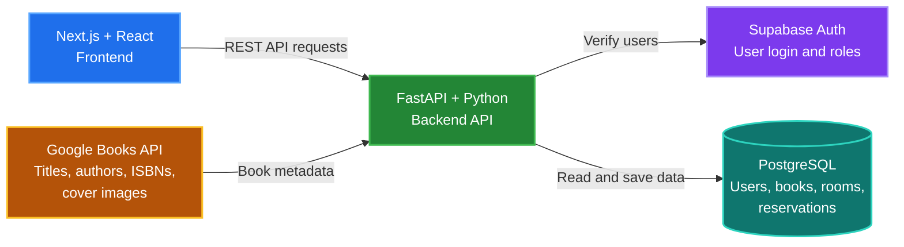

## Libro
A multi-library platform for students to search and rent books, reserve study rooms, and view library availability.

## Tech stack

| Area | Technology |
| --- | --- |
| Frontend | Next.js, React, TypeScript, Tailwind CSS |
| Backend | FastAPI, Python |
| Data | Google Books API|
| Auth and Database | PostgreSQL, Supabase |
| AI | TBD |
| DevOps | Docker Compose, GitHub Actions|
| Deployment | TBD |
| Testing| TBD |

## System Design

## Team
- Emanuel Mora
- Jaden Morales
- Simon Salazar-Marin
- Tanner Slaughter
