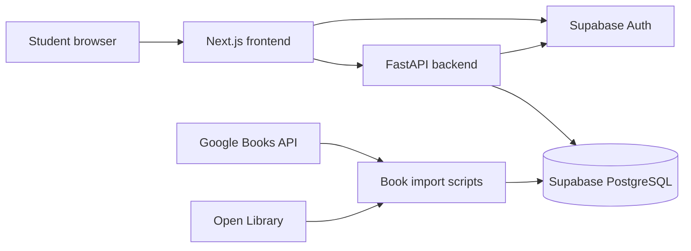

# Libro

**Libro is a library web app for finding books, checking them out, reserving study rooms, and viewing your library activity.**

## Features

- Create an account, confirm your email, and sign in with Supabase Auth.
- Browse and search the book catalog by title, author, or ISBN.
- Open a book detail page to see its cover, description, categories, and ratings when available.
- Check out available books and return them from the dashboard.
- Select study rooms from an Addlestone floor map or room list, then reserve a date and time.
- Join a room waitlist when a time slot is booked. A cancellation can promote a waiting request.
- View book loans, room reservations, waitlist entries, and equipment loans on the dashboard.
- Browse equipment inventory, check out available items, and return them from the dashboard.
- Use the Lock In study timer.

## Architecture



The frontend uses Supabase Auth for registration and login. It sends an access token to FastAPI for protected actions. FastAPI verifies the user, handles book loans, equipment loans and room reservations, and reads or updates PostgreSQL records.

Book import scripts use Google Books metadata and covers, with Open Library as a fallback. These scripts populate the catalog; the book search page reads Libro’s database.

## Tech stack

| Area | Technology |
| --- | --- |
| Frontend | Next.js, React, TypeScript, Tailwind CSS |
| Backend | FastAPI, Python |
| Authentication | Supabase Auth |
| Database | Supabase PostgreSQL |
| Book data | Google Books API, Open Library |

## Run locally

### Prerequisites

- Node.js and npm
- Python 3.12+
- A Supabase project with Libro’s database tables and migrations
- A Google Books API key only if you plan to run the book import scripts

### Database setup

For a new Supabase project, run the SQL files in `supabase/migrations` in filename order. The first migration creates the library, book, study room, loan, and reservation tables. Later migrations add profiles, room waitlists, overlap protection, equipment inventory and loans, and book details. An existing project should run only migrations it has not already applied.

The core-table migration enables Row Level Security. Visitors can read libraries, books, and study rooms; loans and reservations are accessed through FastAPI after it verifies the user's token. Keep `SUPABASE_SECRET_KEY` on the backend only. On an existing project, deploy the updated backend before applying the core-table migration, because it removes direct access to loans and reservations through the publishable key.

### Backend

Create `backend/.env` with values from your Supabase project:

```env
SUPABASE_URL=https://your-project-ref.supabase.co
SUPABASE_KEY=your-publishable-or-anon-key
SUPABASE_SECRET_KEY=your-secret-or-service-role-key
GOOGLE_BOOKS_API_KEY=your-key-if-importing-books
```

Keep `SUPABASE_SECRET_KEY` on the backend only. From the repository root:

```bash
cd backend
python -m venv .venv
source .venv/bin/activate
pip install -r requirements.txt
uvicorn main:app --reload
```

The API runs at `http://127.0.0.1:8000`. Check `http://127.0.0.1:8000/health` to confirm it started.

### Frontend

In a second terminal, from the repository root:

```bash
cd frontend
cp .env.example .env.local
npm ci
npm run dev
```

Fill in `frontend/.env.local`:

```env
NEXT_PUBLIC_SUPABASE_URL=https://your-project-ref.supabase.co
NEXT_PUBLIC_SUPABASE_PUBLISHABLE_KEY=your-publishable-key
```

Open `http://localhost:3000`.

## Project structure

```text
libro/
├── backend/
│   ├── main.py                 # FastAPI application
│   ├── routers/                # Books, rooms, users, and equipment endpoints
│   └── *.py                    # Catalog import and cover scripts
├── frontend/
│   └── src/app/                # Next.js pages
└── supabase/
    └── migrations/             # Database changes and room functions
```

## Checks

```bash
cd frontend
npm run lint
npm run build
```

The backend also exposes interactive API documentation at `http://127.0.0.1:8000/docs` while it is running.

## Team

- Emanuel Mora
- Jaden Morales
- Simon Salazar-Marin
- Tanner Slaughter